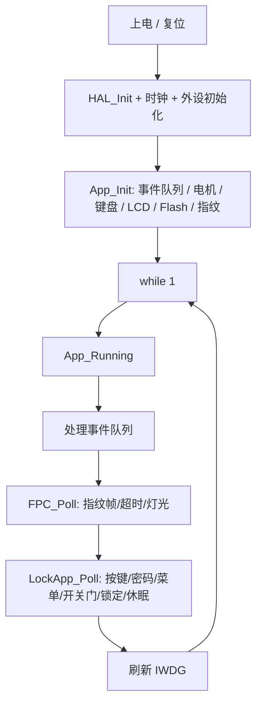
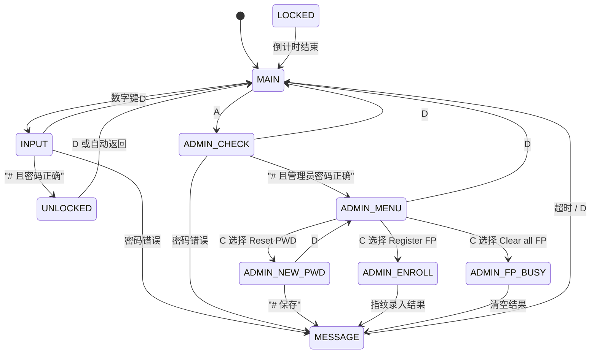
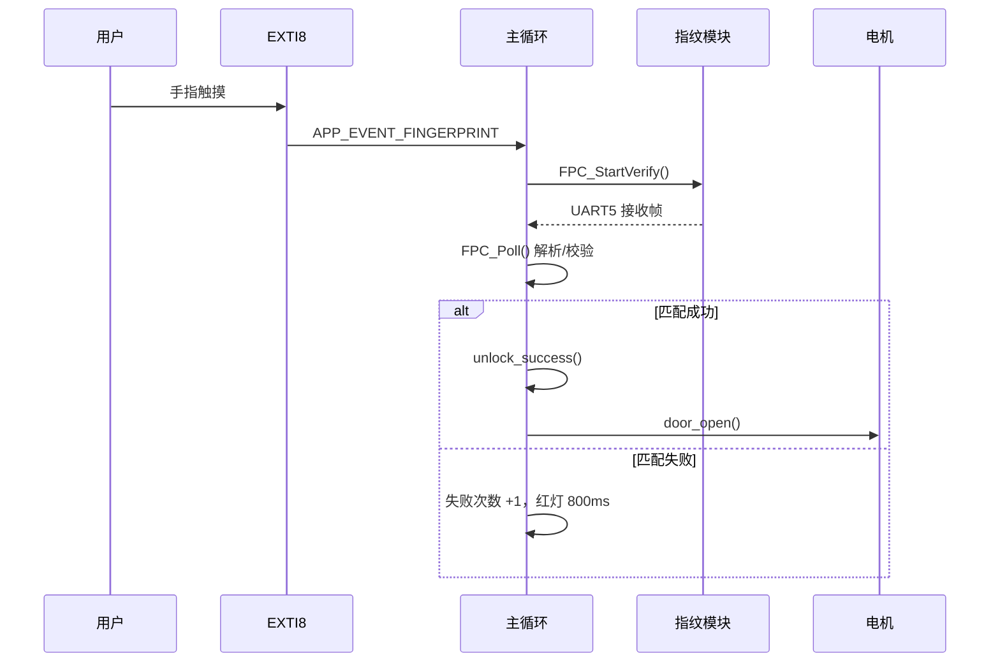

# Awesome Lock

基于 **STM32F407VET6** 的宿舍门禁锁固件：密码 / 指纹开锁、1.8" TFT 显示、4×4 矩阵键盘、28BYJ-48 步进电机驱动门锁，支持管理员菜单、指纹录入/清空、防暴力破解锁定和自动熄屏。

> 当前版本：**v2.1（稳定版）**
>
> 这一版重点修复了重构后实机出现的“开门/关门过程中卡死、自动复位”问题：最终将电机驱动恢复为重构前的实现，并保留显示、休眠、指纹、掉电存储等重构改进。

## 功能一览

- 密码开锁，密码保存在 Flash（Sector 5），带 CRC32 校验
- 指纹验证 / 录入 / 清空，指纹匹配采用严格确认包判定
- 管理员菜单：`Reset PWD`、`Register FP`、`Clear all FP`
- 密码连续错误 3 次进入锁机倒计时（默认 600 秒）
- 开门后自动关门、自动返回主界面
- 5 秒无操作自动熄屏；按键 / 指纹触摸 / 人体感应唤醒
- 锁机倒计时只刷新数字脏区，不整屏重绘
- 独立看门狗，主循环异常可自动复位

## 硬件

| 模块 | 型号 / 接口 |
| --- | --- |
| MCU | STM32F407VET6，168 MHz |
| 显示 | ST7735S 128×160 TFT，硬件 SPI2 |
| 键盘 | 4×4 矩阵键盘，I2C（地址 `0x65`）+ 中断 |
| 指纹 | FPM10A 类模块，UART5，57600 8N1 |
| 电机 | 28BYJ-48 + ULN2003，TIM6 步进 |
| 存储 | 内部 Flash Sector 5（`0x08020000`） |
| 调试串口 | USART1，9600 8N1（默认关闭输出） |

---

# 工作流程

这一章按“上电 → 主循环 → 各个业务分支”的顺序说明固件是怎么跑起来的。

## 1. 上电启动

`main()` 的启动顺序：

1. `HAL_Init()`：HAL、SysTick、NVIC 优先级分组；
2. `SystemClock_Config()`：168 MHz，APB1 定时器时钟 84 MHz；
3. 初始化 GPIO、I2C1、SPI2、TIM6、USART1、UART5、IWDG；
4. `Report_Reset_Cause()`：打印/记录上次复位原因；
5. `App_Init()`：
   - `AppEvents_Init()`：清空事件队列；
   - 关闭 LED1 / LED2；
   - `StepperMotor_Init(&htim6)`：停止 TIM6，线圈断电；
   - `Keyboard_Init()`：清按键中断；
   - `LCD_Init()`：初始化 ST7735S；
   - `LockApp_Init()`：加载 Flash 密码、画主界面、初始化指纹并设置蓝色呼吸灯；
6. 进入 `while (1) { App_Running(); }`。

## 2. 主循环与中断分工

固件采用“**中断只投递事件，主循环做所有业务**”的结构。



中断源：

| 中断 | 作用 | 优先级 |
| --- | --- | --- |
| TIM6 | 每 980 µs 走一步电机 | 0 |
| SysTick | 1 ms 系统 tick，所有 `HAL_GetTick()` 超时基准 | 1 |
| UART5 | 指纹模块收发，逐字节解析成帧 | 2 |
| EXTI0 / EXTI9_5 | 人体感应、按键、指纹触摸 | 3 |

> 本工程使用 `NVIC_PRIORITYGROUP_4`：4 位全部是抢占优先级，**子优先级必须为 0**。`.ioc` 里所有 NVIC 行的 subpriority 已清零；否则 CubeMX 会报“优先级分组和优先级冲突”。

关键约束：

- **所有 ISR 都不调用带 tick 超时的阻塞 HAL 函数**；
- EXTI 只调用 `AppEvents_PushFromISR()`；
- UART5 ISR 只做字节搬运和帧解析，完整帧放入队列；
- 电机 TIM6 ISR 只做一步线圈切换和计数；
- 这样 SysTick 不需要最高优先级，也不会被外设 ISR 饿死。

## 3. 状态机总览



状态说明：

| 状态 | 含义 |
| --- | --- |
| `MAIN` | 主界面，显示“已上锁” |
| `INPUT` | 输入开门密码 |
| `ADMIN_CHECK` | 输入管理员密码 |
| `ADMIN_MENU` | 管理员菜单，A/B 上下移动，C 选择，D 返回 |
| `ADMIN_NEW_PWD` | 输入新密码 |
| `ADMIN_ENROLL` | 等待指纹录入结果 |
| `ADMIN_FP_BUSY` | 等待清空指纹库结果 |
| `UNLOCKED` | 已开门，等待自动关门/返回 |
| `MESSAGE` | 提示界面，超时或按 D 返回来源界面 |
| `LOCKED` | 密码错误次数过多，锁机倒计时 |

> 指纹连续失败 3 次只会**禁用指纹**，仍可用密码开门；密码连续错误 3 次才会进入 `LOCKED` 锁机。

## 4. 密码开门流程

1. 主界面按 **数字键** → 进入 `INPUT`；
2. 数字键追加，`*` 退格，`D` 返回主界面；
3. 按 `#` 确认：
   - `pwd_equals(FLASH_EEPROM_GetPassword())` 成立 → `unlock_success()`；
   - 否则 `password_failed()`：提示 `Wrong password`，错误次数 +1；
   - 连续 3 次错误 → `lockout_enter()`。
4. `unlock_success()` 依次执行：
   - 清空密码、错误计数；
   - 切到 `UNLOCKED`，画“密码正确/欢迎回宿”界面；
   - `door_open()` 启动电机；
   - 设置 `s_door_close_at = now + 2500 ms`；
   - 设置 `s_auto_return_at = now + 4000 ms`；
   - 指纹灯变绿，1.2 秒后恢复蓝色呼吸灯。

## 5. 指纹开门流程



细节：

- 指纹触摸 PE8 上升沿 → EXTI → 事件队列；
- 主循环 `fp_touch()` 只在 `MAIN` / `INPUT` 状态启动验证；
- `FPC_StartVerify()` 发送 `0x01` 验证命令（`32 50 FF FF 00 00`）；
- UART5 中断逐字节喂给解析器，完整帧进入队列；
- `FPC_Poll()` 在主循环处理帧，严格判定 `status == 0x00 && data[1] == 0x05` 才算匹配；
- 成功后回调 `on_fp_event()` → `unlock_success()`；
- 验证超时 3 秒；超时/通信失败不惩罚用户；
- 连续失败 3 次后禁用指纹，需用密码成功开门后清零。

## 6. 开门 / 保持 / 关门时序

开门和关门使用同一个函数：

```c
StepperMotor_RotateAngle(direction, 75.0f, 490);
```

按 28BYJ-48 4096 半步/圈计算：

```text
75° → 853 步
490 × 2 µs = 980 µs/步
853 × 980 µs ≈ 0.84 s
```

时序：

```text
t=0        密码/指纹正确，UI 显示成功，电机开始开门
t≈0.84s    开门到位，StepperMotor_HoldPosition() 保持扭矩，LED2 亮
t=2.5s     自动关门开始（约 0.84s）
t≈3.34s    关门完成
t=4.0s     自动返回主界面（若门已完全关好）
```

保护逻辑：

- 电机启动时记录 `s_motor_deadline`；
- 超过约 2 倍正常时间仍未结束 → `MOTOR TIMEOUT`，强制 `HoldPosition()`；
- 开门过程中如果又请求关门，先置 `s_close_requested`，等当前动作结束再关门；
- 关门完成后不再保持扭矩，避免线圈长期发热。

## 7. 锁机倒计时

密码连续错误 3 次：

1. `lockout_enter()` 切到 `LOCKED`；
2. `s_lockout_until = now + 600s`；
3. 画一次完整锁机界面；
4. 每秒只刷新数字区域：

```c
/* UI_UpdateLockedCountdown() */
LCD_Fill(39, 77, 72, 94, SILVER);
LCD_ShowNum(40, 78, remaining, 4, Font_8x16, RED);
```

5. 倒计时结束自动回主界面；
6. 锁机期间不响应按键、不熄灭屏幕。

## 8. 休眠与唤醒

允许休眠的状态：

`MAIN`、`INPUT`、`ADMIN_CHECK`、`ADMIN_MENU`、`ADMIN_NEW_PWD`。

规则：

- 5 秒没有有效操作 → 如果不在主界面，先回主界面；然后 `s_sleeping = true`，关闭背光；
- 按键 / 指纹触摸 / 人体感应 → 唤醒，打开背光，重置 5 秒计时；
- 休眠时按下的**第一个按键只用于唤醒**，不参与密码输入；
- 指纹触摸唤醒后会继续执行指纹验证，不需要再按一次；
- 开门中、锁机中、指纹录入/清空中不熄屏；
- Hall/门磁中断已关闭（当前业务没有使用门磁）。

## 9. 管理员菜单

主界面按 `A` → 输入管理员密码（`ADMIN_PWD`，默认 `84364323`）→ 进入菜单。

| 菜单项 | 操作 |
| --- | --- |
| `Reset PWD` | 输入新密码（至少 4 位），`#` 保存到 Flash，回主界面 |
| `Register FP` | 启动指纹录入，模块等待手指，最长 20 秒 |
| `Clear all FP` | 清空指纹库，等待模块返回 |

按键：

- `A` / `B`：菜单上下移动；
- `C`：选择当前项；
- `D`：返回上一级 / 主界面。

## 10. 密码存储

```text
Flash Sector 5 @ 0x08020000
┌────────┬─────────┬────────┬──────────────┬───────┐
│ magic  │ version │ length │ password[32] │ CRC32 │
└────────┴─────────┴────────┴──────────────┴───────┘
```

- 上电 `FLASH_EEPROM_Init()` 读取并校验 magic / version / length / CRC32；
- 校验失败或空白 → 回退出厂密码 `1234`；
- 保存时先喂狗，再关中断执行“擦除 Sector 5 → 编程 → 回读校验”；
- 全片擦除会清掉 Sector 5，密码恢复为 `1234`。

## 11. 显示刷新策略

- 使用硬件 SPI2，ST7735S 128×160；
- 不再使用整屏 framebuffer，避免 RAM 和中文显示问题；
- 文字/图片逐点直写，清屏、矩形、横竖线使用批量 SPI；
- 普通界面切换整屏重绘；
- 锁机倒计时只刷新数字脏区；
- 密码输入只刷新密码点区域。

---

# 快速开始

## Keil MDK

1. 用 Keil MDK（ARM Compiler 6）打开 `MDK-ARM/Awesome_Lock.uvprojx`；
2. 编译并下载到 `0x08000000`；
3. 首次启动密码为 `1234`，管理员密码见 `Config/Config.h` 的 `ADMIN_PWD`。

## EIDE / VS Code

用 EIDE 打开 `MDK-ARM/Awesome_Lock.code-workspace`，选择 ARM Compiler 6 后编译下载。

> 仓库不跟踪 `.hex` / `.bin`（见 `.gitignore`），请本地编译生成。
>
> 如果从旧固件升级：密码存储已从 Sector 3 移到 Sector 5，旧密码不会沿用；首次启动请用默认密码 `1234`，再进管理员菜单修改。

> 用 CubeMX 重新生成代码时：.ioc 已同步 **TIM6=167/199**、**PE7 普通输入**、**Stack=0x2000**、NVIC 8 字段格式；生成后请确认 TICK_INT_PRIORITY=1、DEBUG_UART_ENABLE=0，以及 PE7 没有被重新打开成 EXTI。

# 关键配置

所有可调参数集中在 [`Config/Config.h`](Config/Config.h)：

| 参数 | 默认值 | 说明 |
| --- | --- | --- |
| `OPEN_DOOR_ANGLE` | `75` | 开门旋转角度（度） |
| `OPEN_DOOR_STEP_US` | `490` | 步进间隔；配合 TIM6 500 kHz 时为 980 µs |
| `OPEN_DOOR_TIME_MS` | `2500` | 开门后自动关门时间 |
| `OPEN_DOOR_HOLD_MS` | `4000` | 开门后返回主界面时间 |
| `SLEEPING_TIME` | `5` | 无操作熄屏时间（秒） |
| `FAIL_LOCK_COUNT` | `3` | 密码连续错误锁定次数 |
| `FAIL_LOCK_TIME` | `600` | 锁机时间（秒） |
| `FGP_MAX_VERIFY` | `3` | 指纹连续失败禁用次数 |
| `FPC_VERIFY_CONFIRM_BYTE` | `0x05` | 指纹匹配确认字节 |

### 电机时序（重要）

当前 TIM6 配置为：

```c
htim6.Init.Prescaler = 167;   /* 84 MHz / 168 = 500 kHz，2 µs/计数 */
htim6.Init.Period    = 199;
```

`OPEN_DOOR_STEP_US = 490`，实际步进间隔为 `490 × 2 µs = 980 µs`。

> 如果以后把 TIM6 改回 1 MHz（`Prescaler=83, Period=499`），必须把 `OPEN_DOOR_STEP_US` 同步改成 `980`，否则电机速度会不对。

# 目录结构

```text
App/        应用初始化、主循环、事件队列、调试串口
Service/    门锁状态机（lock_app）、显示层（ui_views）
Hardware/   LCD、键盘、指纹、步进电机、Flash 密码存储
Config/     所有可调参数
Core/       CubeMX 生成的时钟、GPIO、中断、HAL 配置
Drivers/    STM32F4 HAL 与 CMSIS
docs/       重构说明、测试清单
MDK-ARM/    Keil 工程与启动文件
```

# 调试串口

调试输出默认关闭（现场不接 USART1 时避免日志阻塞主循环）：

```c
/* App/Debug.c */
#define DEBUG_UART_ENABLE 0
```

需要抓日志时改为 `1` 重新编译，USART1 9600 8N1 输出启动信息、指纹结果、电机状态等。

# 常见问题

**Q：默认密码是多少？**  
A：开门密码 `1234`；管理员密码见 `Config/Config.h` 的 `ADMIN_PWD`（默认 `84364323`）。

**Q：Keil 里注释乱码？**  
A：源码是 UTF-8。把 Keil 的 **Edit → Configuration → Encoding** 设为 **UTF-8**。

**Q：电机速度不对 / 开门角度不对？**  
A：`OPEN_DOOR_STEP_US` 必须与 TIM6 分频/重载匹配；当前是 490 + 167/199。角度改 `OPEN_DOOR_ANGLE`。

**Q：烧录后密码不是原来的？**  
A：密码在 Sector 5；全片擦除或从旧版 Sector 3 升级都会恢复默认 `1234`。

**Q：Hall/门磁没反应？**  
A：当前版本没有使用门磁，PE7 只做普通输入，EXTI7 已关闭。

# 文档

- [重构说明与问题分析](docs/重构说明.md)
- [硬件联调测试清单](docs/测试清单.md)

# License

本项目采用 **MIT License**，详见 [LICENSE](LICENSE)。

```text
MIT License

Copyright (c) 2026 Bury

Permission is hereby granted, free of charge, to any person obtaining a copy
of this software and associated documentation files (the "Software"), to deal
in the Software without restriction, including without limitation the rights
to use, copy, modify, merge, publish, distribute, sublicense, and/or sell
copies of the Software, and to permit persons to whom the Software is
furnished to do so, subject to the following conditions:

The above copyright notice and this permission notice shall be included in all
copies or substantial portions of the Software.

THE SOFTWARE IS PROVIDED "AS IS", WITHOUT WARRANTY OF ANY KIND, EXPRESS OR
IMPLIED, INCLUDING BUT NOT LIMITED TO THE WARRANTIES OF MERCHANTABILITY,
FITNESS FOR A PARTICULAR PURPOSE AND NONINFRINGEMENT. IN NO EVENT SHALL THE
AUTHORS OR COPYRIGHT HOLDERS BE LIABLE FOR ANY CLAIM, DAMAGES OR OTHER
LIABILITY, WHETHER IN AN ACTION OF CONTRACT, TORT OR OTHERWISE, ARISING FROM,
OUT OF OR IN CONNECTION WITH THE SOFTWARE OR THE USE OR OTHER DEALINGS IN THE
SOFTWARE.
```
